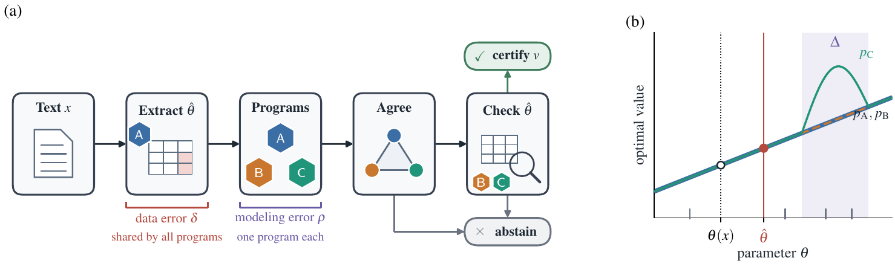
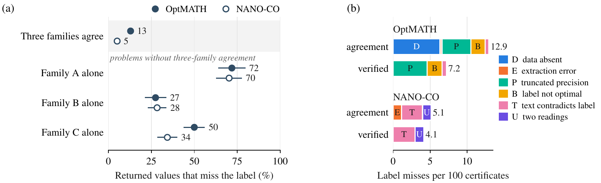
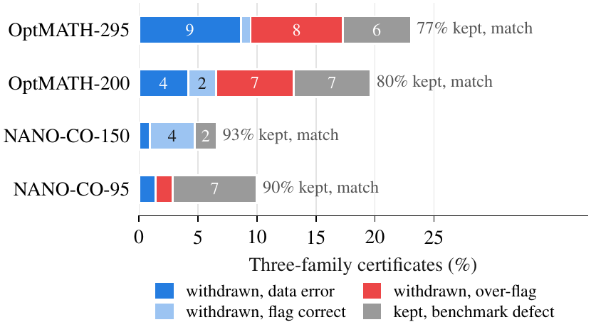

<div align="center">

# AdmitOR

### Label-Free Certification of LLM-Generated Optimization Models:<br>Agreement Across Model Families and Data Verification

**Junbo Jacob Lian** &nbsp;·&nbsp; **Huiling Chen** &nbsp;·&nbsp; **Hanzhang Qin** &nbsp;·&nbsp; **Chung-Piaw Teo**

[](https://arxiv.org/abs/2608.15565)
[](https://github.com/junbolian/AdmitOR/releases/tag/v2.1.1)
[](https://opensource.org/licenses/MIT)
[](https://www.python.org/downloads/)

[**Paper**](https://arxiv.org/abs/2608.15565) &nbsp;·&nbsp; [**Run records**](artifacts/v2/README.md) &nbsp;·&nbsp; [**Audit**](artifacts/v2/audit/AUDIT.md) &nbsp;·&nbsp; [**Audit, human-written texts**](artifacts/v2/audit/AUDIT_human_texts.md)

</div>

A large language model can turn a written problem description into an optimization model, and a
solver then returns a value. AdmitOR decides, without a reference answer, whether that value can be
trusted. One model extracts the problem data. Models from three families each write a program that
reads these data and returns the optimal value. The value is certified when the three programs return
it and when the two families that did not perform the extraction find no difference between the
extracted data and the problem text. Otherwise AdmitOR abstains.



**(a)** The certifier. Family A extracts the data, each family writes and solves a program, and the
value is certified when the three programs agree and families B and C find no difference between the
extracted data and the text. A data error enters before the programs and is shared by all of them. A
modeling error enters in a single program. **(b)** Optimal value as a function of one parameter.
Resampled instances that fall where an incorrect program differs separate it from the correct ones.
When the extracted data differ from the text, all programs agree at the extracted data, and neither
agreement nor resampling reveals the error.



**(a)** Share of returned values that miss the benchmark label, on the problems where the three
families agree and for each family alone on the other problems. **(b)** Label misses per 100
three-family certificates by source, before and after data verification.

## What the paper shows

- **Error model.** The error rate of an agreement certificate equals the share of data errors up to
  the odds of a modeling error that all agreeing programs share. Adding model families lowers the
  second term geometrically and leaves the first in place. Agreement on resampled instances removes
  no data error, and additional programs from the same families raise the odds of a shared error.
- **Audit.** On 740 problems with generated texts, three-family agreement issues 587 certificates,
  and 63 of them miss the benchmark label. Every miss was checked against the problem text. None is a
  shared modeling error. In 30, the programs agree on extracted data that the text does not support.
  The other 33 are defects of the benchmark texts and labels.
- **Data verification.** A check of the extracted data by the two other families withdraws all 30,
  including all seven on 200 problems that were drawn after the rule had been set.
- **Human-written texts.** On IndustryOR and Mamo ComplexLP, three-family agreement reaches a label
  precision of 0.55 on the published releases and 0.95 on the releases with corrected texts and
  answers. The three families share a modeling error only where a text leaves a decision open: on 26
  diet problems that do not say whether portions are integral, all three use continuous quantities,
  and once the corrected texts state integrality, all 26 certificates match the answer.
- **Benchmark defects.** At least 65 of 495 sampled OptMATH-Train problems and 21 of the 245 NANO-CO
  problems carry a label that their text does not determine.

## Main results

Coverage / label precision ± binomial standard error.

| Rule | OptMATH-295 | OptMATH-200 | NANO-CO-150 | NANO-CO-95 |
|---|---|---|---|---|
| Family A alone | 0.898 / 0.807 ± 0.024 | 0.890 / 0.854 ± 0.026 | 0.887 / 0.820 ± 0.033 | 0.842 / 0.863 ± 0.038 |
| Family B alone | 0.922 / 0.838 ± 0.022 | 0.945 / 0.878 ± 0.024 | 0.993 / 0.893 ± 0.025 | 0.990 / 0.872 ± 0.034 |
| Family C alone | 0.966 / 0.796 ± 0.024 | 0.955 / 0.853 ± 0.026 | 0.993 / 0.886 ± 0.026 | 0.990 / 0.840 ± 0.038 |
| Two families agree | 0.925 / 0.835 ± 0.022 | 0.920 / 0.886 ± 0.023 | 0.980 / 0.898 ± 0.025 | 0.979 / 0.871 ± 0.035 |
| Three families agree | 0.824 / 0.856 ± 0.022 | 0.840 / 0.887 ± 0.024 | 0.707 / 0.972 ± 0.016 | 0.737 / 0.914 ± 0.034 |
| Three families, resampled | 0.759 / 0.866 ± 0.023 | 0.795 / 0.893 ± 0.025 | 0.633 / 0.990 ± 0.011 | 0.621 / 0.915 ± 0.036 |
| Two families, verified | 0.756 / 0.915 ± 0.019 | 0.780 / 0.929 ± 0.021 | 0.907 / 0.919 ± 0.023 | 0.937 / 0.876 ± 0.035 |
| Three families, verified | 0.681 / 0.930 ± 0.018 | 0.730 / 0.925 ± 0.022 | 0.673 / 0.980 ± 0.014 | 0.716 / 0.926 ± 0.032 |

Family A is DeepSeek-V4-Flash (it also extracts the data), family B is GPT-6.1 Sol, and family C is
Claude Sonnet 5.5. Label precision understates the precision of the certifier here, because most
remaining label misses are benchmark defects (see the [audit](artifacts/v2/audit/AUDIT.md)).



### Human-written texts

IndustryOR and Mamo ComplexLP pooled: the published releases (311 problems, published labels) and the
releases with corrected texts and answers of the OptiMind authors (309 problems). Coverage / label
precision ± binomial standard error.

| Rule | Published releases | Corrected releases |
|---|---|---|
| Family B alone | 0.929 / 0.540 ± 0.029 | 0.987 / 0.911 ± 0.016 |
| Two families agree | 0.865 / 0.565 ± 0.030 | 0.942 / 0.914 ± 0.016 |
| Three families agree | 0.666 / 0.556 ± 0.035 | 0.725 / 0.946 ± 0.015 |
| Three families, resampled | 0.559 / 0.534 ± 0.038 | 0.618 / 0.937 ± 0.018 |
| Three families, verified | 0.543 / 0.580 ± 0.038 | 0.628 / 0.954 ± 0.015 |

Every three-family label miss on both releases is classified in
[`AUDIT_human_texts.md`](artifacts/v2/audit/AUDIT_human_texts.md).

## Data

| Set | Problems | Source |
|---|---:|---|
| OptMATH-295 | 295 | Uniform random sample of 300 records of OptMATH-Train, `random.Random(42).sample(range(201071), 300)`, without the five problems used during development |
| OptMATH-200 | 200 | Uniform random sample with seed 42 from the 200,771 records outside the first sample, fixed before any model was run on it |
| NANO-CO-150 | 150 | Part of NANO-CO whose labels fit the threshold of the resampling rule |
| NANO-CO-95 | 95 | The remaining NANO-CO problems |
| IndustryOR | 100 | Published release (`datasets/benchmark/industryor.jsonl`) |
| Mamo ComplexLP | 211 | Published release (`datasets/benchmark/mamo_complex_test.jsonl`) |
| IndustryOR, corrected | 99 | Release of the OptiMind authors, `microsoft/OptiGuide` at commit `3da334a` (`datasets/optimind_corrected/`) |
| Mamo ComplexLP, corrected | 210 | Same source |

## Installation

```bash
conda env create -f environment.yml -n optskills
conda activate optskills
pytest -q          # offline, no API key
```

HiGHS is installed with the environment. Gurobi is optional and needed only to run family C live.

## Reproduce the tables and figures

Both commands read `artifacts/v2/` only and need no key.

```bash
python scripts/paper_tables.py
python scripts/make_figures.py
```

## Run the certifier

Set the key, the base address, and the model name of each family in the environment
(`ADMITOR_API_KEY_A`, `ADMITOR_BASE_URL_A`, `ADMITOR_MODEL_A`, and the same with `_B` and `_C`).

```bash
python -m admitor.pipeline_one --mock                       # offline self-test
python scripts/e1_certify.py --work-order <file> --verdicts-dir <dir> --runs-dir <dir> --m 5 --sampler param_screen --both
python scripts/data_verification.py --runs <dir> --work-order <file> --out <dir>
```

## Repository layout

```
AdmitOR/
├── admitor/          extraction, program generation, agreement
├── scripts/          certification, data verification, tables, figures, and earlier analyses
├── artifacts/v2/     run records of this version: per-problem extractions, programs,
│                     values, verification replies, audit, tables, downstream results;
│                     humanbench/ and optimind/ hold the runs on human-written texts
├── figures/          figures of the paper (PDF and PNG)
├── datasets/         third-party benchmarks and corrected releases (see datasets/README.md)
├── patches/          changes to the OptSkills host as unified diffs
├── tests/            offline tests
├── artifacts/e1, artifacts/e3, release/   records of the earlier version (tag v1.1.0)
└── release_tools/    log scrubbing and manifest
```

## Earlier version

The code and records of the earlier version of this work, which used resampled agreement as an
admission gate for an experience library, are available under the tag
[`v1.1.0`](https://github.com/junbolian/AdmitOR/releases/tag/v1.1.0).

## Citation

```bibtex
@article{lian2026admitor,
  title   = {Label-Free Certification of {LLM}-Generated Optimization Models:
             Agreement Across Model Families and Data Verification},
  author  = {Lian, Junbo Jacob and Chen, Huiling and Qin, Hanzhang and
             Teo, Chung-Piaw},
  journal = {arXiv preprint arXiv:2608.15565},
  year    = {2026},
  eprint  = {2608.15565},
  archivePrefix = {arXiv},
  primaryClass  = {cs.AI},
  url     = {https://arxiv.org/abs/2608.15565}
}
```

## License and acknowledgements

MIT, see [`LICENSE`](LICENSE). Datasets under `datasets/` are third-party and keep their own terms
([attribution](datasets/README.md)).

The downstream experiments run inside [OptSkills](https://github.com/fujiwaranoM0kou/OptSkills)
(Yang, Zhao, Ma, Lu, Wang, Qian, arXiv:2605.29829), and we thank its authors. No host source is
redistributed; our changes ship as unified diffs in [`patches/`](patches/).
